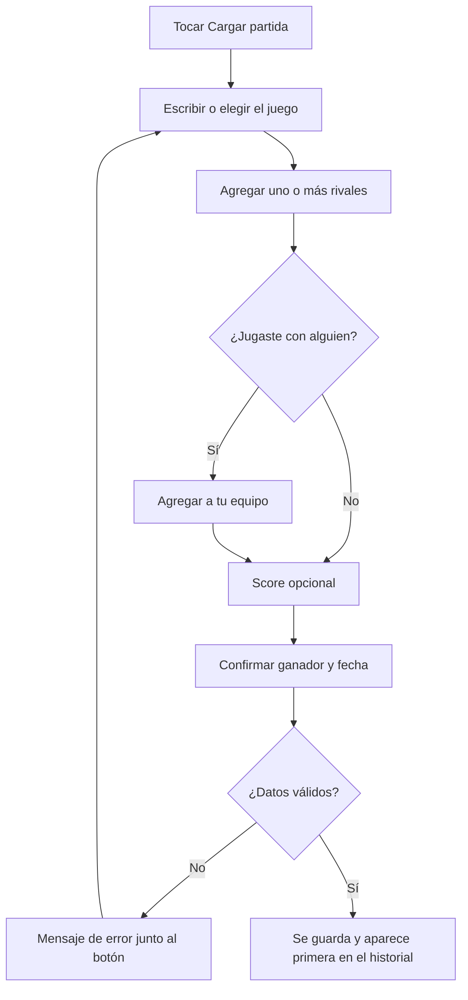

# 03 · Partidas

## Datos de una partida

Estado: **implementado**.

| Dato | Regla |
| --- | --- |
| Juego | Exactamente un tag de juego. |
| Rivales | Uno o más participantes. Es obligatorio al menos uno. |
| Tu equipo | Opcional. Quienes jugaron de tu lado. Vacío significa 1 contra 1. |
| Score | Opcional. Un número por lado, entero y no negativo. Se cargan los dos o ninguno. |
| Ganador | Tu lado, los rivales o empate. |
| Fecha | Por defecto hoy. No admite fechas futuras. |

Una misma persona no puede estar en los dos lados de una partida, ni dos veces en el mismo.

**Siempre hay dos lados.** Quien carga la partida está siempre en "tu lado". No entran juegos de tres o más equipos ni todos contra todos (queda para versiones futuras).

**El score no decide al ganador.** Al escribir los dos puntajes, el ganador se completa solo, pero se puede cambiar a mano. Sirve para juegos donde gana el puntaje más bajo.

Los equipos se arman en cada partida. No hay equipos fijos con nombre en esta versión.

## Cargar una partida

Estado: **implementado**.

El formulario se puede abrir vacío o con datos precargados: desde la pantalla de un contacto arranca con ese rival, y desde la de un juego arranca con ese juego.

### Sugerencias

Los tres campos (juego, rivales, tu equipo) muestran debajo hasta seis tags existentes como botones, que se agregan con un toque.

- **Orden**: por cantidad de partidas en que se usó cada tag, de mayor a menor.
- **Filtro**: se reducen a los que contienen lo que se va escribiendo.
- **Sin repetidos**: no se sugiere a quien ya está elegido en esa partida.
- **Sin mezclar tipos**: juego sugiere juegos; rivales y equipo sugieren personas.
- **Sin autocompletado del navegador**: está desactivado en estos campos, para que no ofrezca valores de otros campos.

En rivales y equipo se pueden escribir varios nombres separados por coma. `Enter` o el botón "Agregar" los suma a la lista.

Mejoras posibles, no definidas: dar más peso a lo usado recientemente, y sugerir según contexto (los rivales más frecuentes para el juego elegido). Ver [10-pendientes.md](10-pendientes.md).

### Validaciones y mensajes

| Situación | Mensaje |
| --- | --- |
| Falta juego, rival o fecha | Completá el juego, al menos un rival y la fecha. |
| Un solo puntaje cargado | Cargá los dos puntajes o dejá los dos vacíos. |
| Un nombre lleva `@` o `*` | Los tags no pueden llevar @ ni *: esos símbolos quedan reservados para las cuentas. |

## Editar y borrar

Estado: **implementado** para partidas personales. Las reglas para partidas pendientes y validadas están en [06-validacion.md](06-validacion.md).

- Cada partida tiene un lápiz que abre el mismo formulario con todos los datos completos.
- Al guardar, la partida queda marcada como **Editada** en el historial.
- **Borrar** está dentro del formulario de edición y pide un segundo toque para confirmar. No hay un botón de borrar suelto en cada fila, para evitar toques accidentales.
- Si al editar se cambia el juego o una persona, el tag anterior puede quedar sin partidas. No se elimina solo.

## Estadísticas

Estado: **implementado**.

Todas se calculan a partir de las partidas cargadas. No se guarda ningún total.

### Historial

Lista de todas las partidas, de la más reciente a la más antigua. A igual fecha, primero la última cargada. Arriba, tres números: jugadas, ganadas y efectividad (porcentaje de ganadas sobre jugadas). Se puede filtrar por juego.

Cada fila muestra: juego, compañeros si los hubo, rivales, fecha, nivel de validación, score si lo hay, y resultado. Por ejemplo: "Truco con Caro vs Juan + Pedro".

### Contactos

Lista de tags de persona, ordenada por cantidad de partidas. Al entrar a uno:

- **Cara a cara**: ganadas y perdidas en las partidas donde esa persona fue rival, empates si los hay, y la racha actual.
- **En el mismo equipo**: aparte, cuántas ganaron juntos. No se mezcla con el cara a cara.
- **Por juego**: el cara a cara desglosado por cada juego.
- **Partidas**: todas las que comparten, como rival o como compañero.

### Juegos

Lista de tags de juego, ordenada por cantidad de partidas. Al entrar a uno: jugadas, ganadas, efectividad, racha, el desglose por rival y las partidas de ese juego.

### Racha

Cantidad de partidas consecutivas con el mismo resultado, contando desde la más reciente. Se muestra como "Racha actual: 3 ganadas".

### Nivel de validación en las estadísticas

En la etapa 1 todas las partidas son personales y cuentan. Con la etapa 2, las estadísticas tienen un filtro para ver solo las validadas. Qué cuenta por defecto está en [10-pendientes.md](10-pendientes.md).
