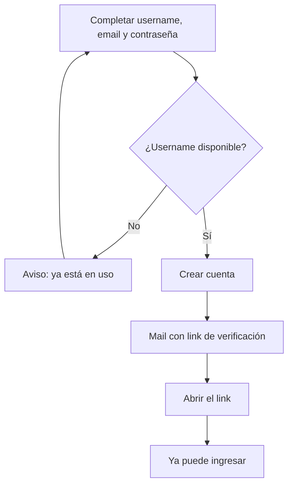

# 04 · Cuentas y perfil

Estado: **implementado**, salvo donde se indica.

## Datos de una cuenta

Una cuenta se crea con tres datos. No hay registro sin email.

| Dato | Reglas |
| --- | --- |
| Username | Único, sin distinguir mayúsculas (`Leo` y `leo` son el mismo). De 3 a 20 caracteres: letras sin acento, números y guion bajo. Es lo que otros buscan para vincularse. |
| Email | Único. Se verifica con un link. No se muestra a otros usuarios. |
| Contraseña | Mínimo 8 caracteres, sin exigir símbolos ni mayúsculas. La guarda el servicio de autenticación; la app nunca la ve ni la almacena. |

## Registro

- La disponibilidad del username se consulta mientras se escribe y se muestra debajo del campo.
- Después de crear la cuenta, la pantalla indica a qué dirección se mandó el mail.
- El email tiene que estar verificado para ingresar.

## Ingreso

- Con **username o email**, indistintamente, más contraseña. Como un username no puede contener `@`, la app distingue cuál de los dos se escribió.
- Ante un dato incorrecto, el mensaje es siempre el mismo: "Usuario o contraseña incorrectos". No revela si el username existe.
- **Olvidé mi contraseña**: se pide el email y se manda un link para elegir una nueva. El aviso es el mismo exista o no la cuenta.

## Perfil

Se entra desde el botón con las iniciales, arriba a la derecha.

| Acción | Comportamiento |
| --- | --- |
| Cambiar username | Mismas reglas que en el registro. El historial de todos muestra el nuevo, porque las partidas guardan la cuenta y no el texto. |
| Cambiar email | Se manda un link a la dirección nueva; el cambio vale recién al confirmarlo. |
| Cambiar contraseña | Mínimo 8 caracteres. |
| Exportar mis datos | Descarga un archivo con todas las partidas, con los nombres de los tags ya resueltos. |
| Cerrar sesión | Vuelve a la pantalla de ingreso. |
| Eliminar mi cuenta | Pide un segundo toque. Borra la cuenta y todos sus datos. No se puede deshacer. |

En la etapa 2 el perfil suma las cuentas vinculadas y las solicitudes de vínculo pendientes (**definido**).

## Eliminación de una cuenta: efecto sobre los demás

Estado: **definido** (etapa 2). En la etapa 1 nadie más tiene datos que dependan de la cuenta.

- El usuario pasa a mostrarse como `@username*` en el historial de quienes jugaron con él.
- Las partidas que otros tenían guardadas contra ese usuario siguen existiendo, bajo `@username*`.
- Los tags que otros tenían vinculados a él quedan sueltos, como antes del vínculo.
- Las partidas ya validadas conservan esa marca, porque la validación ocurrió. Dejan de poder corregirse con él.
- Los usuarios vinculados reciben un aviso en la bandeja.

## Fuera de la primera versión

- Ingreso con Google. Cuando se sume, la persona elige su username en el primer ingreso.
- Foto de perfil.
