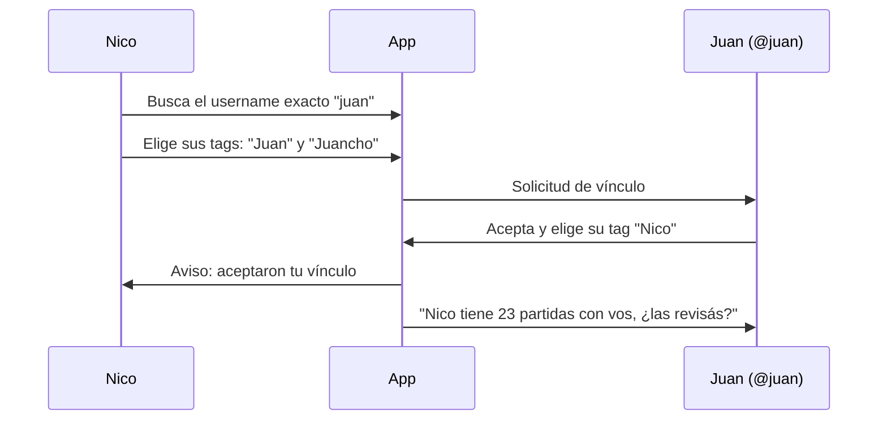

# 05 · Vínculo entre cuentas

Estado: **definido** (etapa 2). La tabla que guarda los vínculos ya existe en la base de datos.

## La idea central

El vínculo es una capa separada que dice "este tag mío corresponde a este usuario". **Nunca reescribe las partidas.**

- La **partida** guarda para siempre al participante tal como se cargó: un tag o un usuario.
- El **vínculo** es una relación aparte entre un tag y un usuario. Se agrega o se quita sin tocar ninguna partida.
- Lo que **se muestra** se calcula en el momento: si el tag de una partida está vinculado, se muestra el usuario y la partida cuenta en su cara a cara.

## Crear un vínculo

- **Búsqueda por username exacto**, no por nombre parecido. La app no funciona como directorio de usuarios.
- El vínculo es una **solicitud**: el otro la acepta o la rechaza. Rechazar no notifica a quien la pidió.
- Se puede **bloquear** a quien insiste. Bloquear tampoco notifica.
- **Cada uno mapea sus propios tags.** Nico vincula `@juan` a sus tags; Juan vincula `@nico` a los suyos. Ninguno ve ni toca los tags del otro.
- **Un usuario puede vincularse a varios tags** de la misma persona, porque es común haber creado más de uno sin querer para alguien.
- Antes de confirmar, la pantalla muestra qué tags y cuántas partidas quedan asociadas.
- El email tiene que estar verificado para vincularse.

### Qué ve el otro

Solo las partidas en las que participa. Nunca los demás contactos, los tags ni las estadísticas generales de la otra persona.

## Efectos de vincular

- **Hacia atrás**: las partidas anteriores siguen guardadas contra su tag original, pero se muestran junto con las del usuario, en un único cara a cara.
- **Hacia adelante**: solo se puede elegir al usuario. Los tags vinculados dejan de ofrecerse en las sugerencias. Si se escribe el nombre de un tag vinculado, la app ofrece al usuario.
- Las partidas nuevas se guardan **contra el usuario**, no contra el tag.

### Partidas anteriores al vínculo

Quedan como personales. Al aceptar el vínculo, se le ofrecen al otro en bloque: "Nico tiene 23 partidas con vos, ¿las revisás?". Puede aceptar todas o ir una por una. Es un único aviso, no uno por partida.

## Desvincular

Desvincular es dejar de mostrar juntos un tag y un usuario. No se pierde ni se mezcla nada.

| Partidas | Antes de desvincular | Después de desvincular |
| --- | --- | --- |
| Cargadas contra el tag `Juan` | Se ven bajo `@juan` | Vuelven a verse bajo `Juan` |
| Cargadas contra el usuario `@juan` | Se ven bajo `@juan` | Siguen bajo `@juan`, por separado |

- Si se vincularon dos tags y después se saca uno, ese tag recupera sus partidas originales y el otro sigue vinculado.
- Volver a vincular los junta otra vez.
- Las partidas ya validadas conservan su estado.

## Mapeo de juegos

Cada persona conserva sus propios tags de juego. Para compatibilizar resultados entre dos personas, se emparejan tags, de uno a uno: "mi `Truco gallo` es tu `Gallo`".

- El mapeo se hace **al validar**: cuando llega una partida, quien la recibe elige a cuál de sus tags corresponde el juego, o crea uno nuevo.
- La app sugiere por nombre parecido, pero la persona decide.
- El mapeo queda guardado para las siguientes partidas entre esas dos personas.
- Nadie tiene que renombrar sus tags.

Por esto los tags de juego no se agrupan en familias: el emparejamiento tiene que ser siempre de un tag a un tag.

## Duplicados

Si dos personas venían anotando las mismas partidas por separado, al vincularse aparecen dos veces. No se puede estar seguro de que sean la misma, así que **la app sugiere y la persona decide**.

- La app detecta candidatas por juego, fecha y score parecido, y las muestra lado a lado.
- Al revisar una partida recibida hay una opción "ya la tengo cargada", que la une con la propia.
- Si las dos versiones tienen resultados distintos, unirlas abre el flujo de corrección normal. No se elige una en silencio.

La foto de evidencia, prevista para más adelante, ayudará a reconocer la partida; no reemplaza la decisión de la persona.
