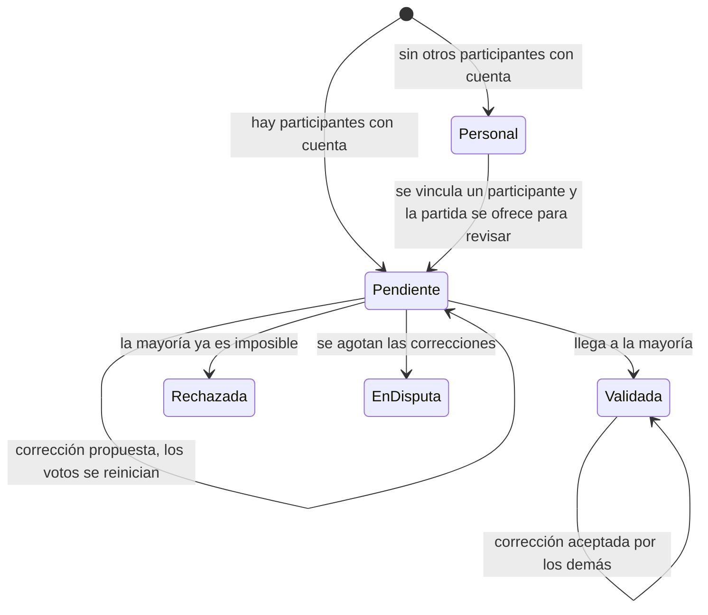

# 06 · Validación

Estado: **definido** (etapa 2).

## Regla de mayoría

Una partida queda validada cuando la aprueba **más de la mitad de los participantes que tienen cuenta**. Quien la carga cuenta como voto a favor.

| Participantes con cuenta | Aprobaciones necesarias | Además de quien la cargó |
| --- | --- | --- |
| 2 | 2 | 1 |
| 3 | 2 | 1 |
| 4 | 3 | 2 |
| 5 | 3 | 2 |

En un 1 contra 1, la mayoría equivale a que el otro acepte.

- **Vota cada persona con cuenta**, incluidos los compañeros de equipo. No es un voto por equipo.
- **Los participantes sin cuenta no votan.** La partida muestra el detalle, por ejemplo "validada por 2 de 4".
- Si ningún otro participante tiene cuenta vinculada, la partida es **personal** y no pasa por validación.

## Qué puede hacer quien recibe una partida

1. **Validar.**
2. **Rechazar.**
3. **Proponer una corrección**: otro resultado, score o fecha.
4. **Ya la tengo cargada**: unirla con una propia (ver [05-vinculo.md](05-vinculo.md), "Duplicados").

Si es la primera partida de ese juego con esa persona, antes elige a qué tag propio corresponde el juego.

## Estados

| Estado | Cuándo |
| --- | --- |
| Personal | Ningún otro participante tiene cuenta vinculada. |
| Pendiente | Cargada, esperando votos. |
| Validada | Llegó a la mayoría. |
| Rechazada | Ya no puede llegar a la mayoría. |
| En disputa | Se agotaron las correcciones sin acuerdo. |

Qué estados cuentan en las estadísticas por defecto está en [10-pendientes.md](10-pendientes.md).

## Reglas

- **Sin vencimiento.** Una partida pendiente queda pendiente hasta que alguien responda. No pasa a personal ni se valida sola por silencio.
- **Sin recordatorios.** Las pendientes se ven en la bandeja.
- **Cada corrección es una nueva versión.** Los votos se reinician y quien la propone cuenta como voto a favor.
- **Límite de correcciones: 10 por partida.** A partir de la octava se avisa a los participantes que quedan 2 antes de que la partida quede en disputa.
- **Se guarda cada versión**, con quién la cambió y cuándo, visible para los participantes.

## Editar y borrar según el estado

| Estado | Editar | Borrar |
| --- | --- | --- |
| Personal | Libre. | Libre. |
| Pendiente | La edita quien la cargó. Los votos se reinician. | La borra quien la cargó. |
| Validada | Solo como propuesta de corrección que los demás aceptan o rechazan. | Solo con el acuerdo de los demás. |

- Mientras una propuesta sobre una partida validada está en curso, sigue valiendo la versión validada.
- Borrar una validada necesita acuerdo porque, si no, cualquiera podría borrar sus derrotas.
- **Un cambio que no toca el resultado no dispara una nueva validación.** Renombrar un tag propio, por ejemplo, es privado de cada uno.
