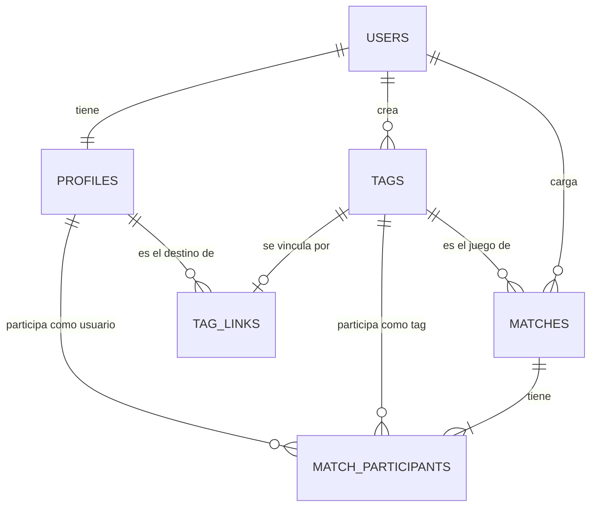

# 09 · Arquitectura

## Tecnologías

| Parte | Elección | Motivo |
| --- | --- | --- |
| Lenguaje | TypeScript en toda la app | Detecta antes de publicar errores como confundir un tag con un usuario. |
| Web | React con Vite, como sitio estático | Es lo más difundido y se puede servir gratis. |
| Base de datos y cuentas | Supabase (Postgres) | Resuelve registro, verificación y recuperación, y permite poner las reglas de privacidad en la base. |
| Funciones de servidor | Supabase Edge Functions (TypeScript) | Para lo que necesita la clave de servicio, sin sumar otro lenguaje. |
| Hosting de la web | Cloudflare Pages | Gratis y permite uso comercial. |
| Mails | Resend, por SMTP desde Supabase | El envío propio de Supabase tiene un límite muy bajo. |

Descartado: Next.js, porque necesita servidor propio y ata en la práctica a un hosting cuyo plan gratis no permite uso comercial.

Es una **web instalable en el celular**. Publicarla en las tiendas de apps queda para más adelante; se puede hacer empaquetando esta misma app, sin reescribirla.

## Dónde vive cada regla

**Las reglas que no pueden depender de la buena fe del usuario van en la base de datos, no en la web.** Alguien con conocimientos puede saltarse cualquier control que esté solo en el navegador.

| Regla | Dónde |
| --- | --- |
| Quién puede ver y modificar cada dato | Base de datos (Row Level Security) |
| Unicidad de usernames y de tags | Base de datos |
| `@` y `*` prohibidos en tags | Base de datos, y también en la web para avisar antes |
| Un juego y sus participantes tienen que ser tags del dueño de la partida | Base de datos |
| Cálculo de la mayoría, límite de correcciones, edición de validadas | Base de datos (etapa 2) |
| Sugerencias, estadísticas, tolerancia a acentos | Web |

## Capas del código

```
src/
  lib/
    tags.ts       Reglas de nombres: comparación, símbolos reservados, username
    stats.ts      Estadísticas: récord, racha, agrupaciones, uso de tags
    supabase.ts   Cliente y traducción de errores a mensajes
    data.ts       Acceso a datos: todo lo que habla con Supabase
  screens/
    Auth.tsx      Ingresar, crear cuenta, recuperar contraseña
    Home.tsx      Pestañas, historial, listas y detalle
    MatchForm.tsx Cargar y editar una partida
    Profile.tsx   Mi perfil
  App.tsx         Sesión y pantalla inicial
  styles.css      Colores, tipografías y componentes
supabase/
  migrations/     Esquema, reglas de seguridad y funciones de la base
  functions/      Funciones de servidor
tests/
  unit/           Pruebas de lib/
  db/             Pruebas de la base sobre un Postgres temporal
```

Criterios:

- `lib/tags.ts` y `lib/stats.ts` son funciones puras, sin acceso a red ni a la interfaz. Por eso se prueban solas.
- Las pantallas no llaman a Supabase directamente: pasan por `lib/data.ts`.
- Las estadísticas se calculan en la web con las partidas ya cargadas. No se guardan totales.

## Modelo de datos



| Tabla | Contenido | Etapa |
| --- | --- | --- |
| `profiles` | Username de cada cuenta | 1 |
| `tags` | Tags de persona y de juego, con su dueño | 1 |
| `matches` | Juego, fecha, score, ganador, dueño y marca de edición | 1 |
| `match_participants` | Un participante por fila: lado, y un tag **o** un usuario, nunca ambos | 1 (solo tags) |
| `tag_links` | Vínculo tag → usuario | 2 (la tabla ya existe) |

Decisiones:

- **El participante es un tag o un usuario**, con una restricción que impide que sea los dos o ninguno. Así la partida conserva para siempre cómo fue cargada.
- **El vínculo está en su propia tabla.** Vincular y desvincular es agregar o quitar una fila ahí.
- **Un tag con partidas no se puede borrar**: lo impide una clave foránea.
- **Guardar una partida es una sola operación** (`save_match`): busca o crea los tags y escribe la partida con sus participantes en una transacción.

Faltan para la etapa 2: votos, versiones de una partida, mapeo de juegos, solicitudes de vínculo, bloqueos y notificaciones.

## Seguridad y privacidad

- **Cada usuario solo lee y modifica sus propios datos.** Lo garantizan las políticas de la base y lo verifican las pruebas.
- **Quien no inició sesión no lee ninguna tabla.** Solo puede consultar si un username está libre.
- **El email no se expone.** El ingreso con username pasa por una función de servidor que busca el email con la clave de servicio; desde el navegador no hay forma de obtener el email de otro.
- **El ingreso no revela qué usernames existen**: el error es siempre el mismo.
- **La contraseña la maneja el servicio de autenticación.** La app no la guarda.
- En la etapa 2, un usuario vinculado ve únicamente las partidas en las que participa.

## Pruebas

| Comando | Qué verifica |
| --- | --- |
| `npm test` | Reglas de nombres y cálculo de estadísticas |
| `npm run test:db` | Esquema, reglas y privacidad, en un Postgres temporal |
| `npm run build` | Que el proyecto compila sin errores de tipos |

Toda regla nueva de la base lleva su prueba en `tests/db/tests.sql`, incluido el caso de un segundo usuario que intenta leer o modificar lo ajeno.

Sin verificar todavía: el funcionamiento contra un proyecto real de Supabase (registro, mails e ingreso con username).

## Hosting y costos

Precios consultados el 8 de octubre de 2026, en dólares.

| Servicio | Plan gratis | Plan pago |
| --- | --- | --- |
| Supabase | 50.000 usuarios activos por mes, 500 MB de base, 2 proyectos | Pro desde US$25/mes |
| Resend | 3.000 mails por mes, 100 por día | Pro US$20/mes |
| Cloudflare Pages | Gratis | No hace falta |
| Dominio | — | Aproximadamente US$10 a 20 por año |

- **Para probar con amigos**: costo cero, más el dominio. El dominio hace falta para mandar mails a otras personas.
- **Para uso real**: unos US$25 por mes (Supabase Pro).
- **Límite a tener presente**: en el plan gratis, Supabase pausa el proyecto tras una semana sin actividad. Se reactiva a mano, sin perder datos.

Los precios de Cloudflare Pages y del dominio no se verificaron en la fuente; conviene confirmarlos.

## Límites conocidos

- La web trae todas las partidas de una vez. Supabase devuelve hasta 1.000 filas por consulta por defecto; más allá hay que paginar.
- Las partidas cargadas en el prototipo interactivo no se importan a la cuenta nueva.
